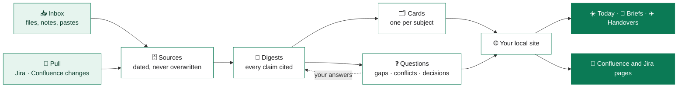

<div align="center">

# Mantis

### Your product knowledge, organised. Your day, briefed. Every claim, cited.

An AI chief of staff for product owners that turns meeting notes, documents and messages into a
living knowledge base, then tells you what to do next.

Built on [Claude Code](https://claude.com/claude-code) · Plain Markdown · Runs on your machine

</div>

---

## The problem

Product owners drown in fragments. Decisions live in meeting notes, requirements in wiki pages,
blockers in chat threads, and the one detail you need is in an email from three weeks ago.
AI assistants help, until they confidently make something up.

**Mantis is the opposite of a guess.** Every statement it keeps points to the source it came
from. When it doesn't know, it says so and adds the question to your list. When two sources
disagree, it shows you both instead of picking one.

## What it does for you

### 📥 Feed it anything
Drop in Word files, PDFs, Confluence exports, meeting transcripts, or just paste a message.
Mantis reads it once, writes a cited summary, and files it under the right subjects.
Unclear names, missing dates and contradictions become questions for you to settle.
A newer version of a document keeps its identity. The old copy is kept, never overwritten.

### 🔄 Pull only what changed
Choose the Jira and Confluence filters you care about. Press Pull and Mantis fetches what
changed since last time, works out the difference, and sets the noise aside: a status flip,
a moved ticket, a formatting-only page edit. What's left is read one feature at a time and
summed up in a short "since last pull" brief. Mantis only reads from Jira and Confluence and
never writes to them.

### 🗂️ One page per subject, always current
Every feature and topic gets a card: a short summary, every source behind it, the open
questions and the people involved. New information shows up on the card the moment it
arrives, flagged until the summary catches up. Feature cards also name the problem, the
outcome and how success will be measured, and Mantis tells you when a feature is ready to
decide on.

### 💬 Ask, and get a sourced answer
Ask *"what's the target for this?"* and get a short answer with quotes from the sources
behind it. The quotes are checked against the sources before you see them. Ask again later
and, if nothing new has come in, you get the same answer without paying for it twice.

### ☀️ A Today page that thinks ahead
Your task list ranks itself: high priority first, then the nearest deadline, then the
shortest task, so you finish something sooner. Group tasks under a feature or a name of your
own; a group ranks with its most urgent task and folds away when you don't need it. Drag a
task or a group to where you want it and it stays there until the task is done. Tasks left
over from earlier days are flagged so you decide on each one, and undated tasks get a
*suggested* deadline with a reason, which you accept or decline. Mantis never sets one
behind your back. Next to the list: what Mantis suggests you do today, and why.

### 🤝 Walk into every meeting prepared
Say *"I'm meeting Sam, what should I discuss?"* and get a brief in seconds: what to update
them on, what to ask, what to decide together, what to chase. Every bullet opens to its
background and source. After the meeting, save the takeaways: your actions become tasks,
what others owe you becomes follow-ups, and the next brief starts from there. Each recurring
meeting has its own page with an agenda that builds itself from what is open with the people
in it, and you can move or skip one occurrence.

### ✈️ Leave without dropping anything
Tell Mantis when you're away. It lists what falls inside that window, nudges you about what
has to happen before you go, and writes the handover for whoever covers, shaped to them:
steps and contacts for an analyst, decisions and priorities for a peer, status and risks
for your manager.

### 📄 From knowledge to Confluence and Jira
Feature pages, epics and stories are written from your sources, following your team's own
format. Before you see a draft, Mantis checks it for sentences that say the same thing
twice. After you paste a page into Confluence, Mantis remembers that version and next time
shows only the sections that changed.

### 🛡️ Checks its own work
Citations are checked on every rebuild, and claims can be checked against the source they
cite. A decision records what it rests on, and Mantis flags it when that changes.

### 🖱️ One click instead of one prompt
Pull what changed (together with your inbox and your answers), refresh a card or write a
brief, all from buttons on the site. They run in the background on your normal AI
subscription and stop to ask you whenever a decision is yours to make.

## How it works



Everything is plain Markdown on your disk. The website is generated from it, so there's no
database to manage and nothing to lock you in. The site has five pages (Today, Meetings,
Features, Questions and Sources), with people and the library in a side panel. Nothing you
do there changes your knowledge directly: answers, page edits and dropped files wait in the
inbox for the next pull.

## Built on three promises

| | |
|---|---|
| **Cited or flagged** | Every statement has a source or is marked as an assumption. There is no third option. |
| **Never silently changed** | Conflicts are recorded, not resolved behind your back. Only you close a question. |
| **Yours, on your machine** | Your knowledge base never leaves your computer. This repository holds the engine only. |

## Your knowledge stays private

This is a public repository, and none of anyone's knowledge is in it, by design:

- **An allow-list `.gitignore`.** Only engine files can be committed. Everything else is skipped by default.
- **A leak check before every commit.** It blocks document IDs, email addresses, company links,
  and every name in your local knowledge: people, teams, products, markets.
- **Instance details live in local files** (`CLAUDE.local.md`, `mantis/config/`) that are never committed.

## Get started in five minutes

You need Python 3.12+, Git, and VS Code with the Claude Code extension.

```bash
git clone https://github.com/priyanshup/Mantis.git
cd Mantis
pip install markdown markdownify python-docx pypdf
python tools/init.py                      # creates your empty, private knowledge base
git config core.hooksPath tools/githooks  # turns on the leak check
python tools/serve.py --open              # opens http://localhost:8000
```

Then:

1. Tell Mantis who you are in `CLAUDE.local.md`.
2. Open the folder in Claude Code.
3. Drop your first documents into `mantis/00_inbox/` and say *"pull"*.
4. Optional: connect Jira and Confluence. Put your keys in `mantis/config/.env`, check them
   with `python tools/atl.py login`, then add filters with `python tools/pull.py filter add`
   or on the Sources page.

The full guide, covering new machines, restarting the site and switching AI provider, is in
[`docs/system/SETUP.md`](docs/system/SETUP.md).

## Not tied to one AI

Mantis runs best on Claude Code, but nothing in your knowledge base depends on it. Other
assistants (Copilot, Codex, Cursor, Gemini) start from [`AGENTS.md`](AGENTS.md) and follow the
same rules. Switch tools and your knowledge comes with you.

## Under the hood

| Path | What's inside |
|---|---|
| `tools/` | Python commands: ingest, pull, check, verify, search, build, serve, tasks, follow-ups, briefs, background jobs |
| `tools/site_assets/` | The website: hand-written CSS and JavaScript, no framework, no build step |
| `docs/rules/` | How Mantis must behave: citing, ingesting, pulling, writing for a reader |
| `docs/rules/workflow/` | One file per task: pull, ingest, answers, questions, your day |
| `docs/system/` | How it's built: architecture, setup, maintenance |
| `mantis/TEMPLATES/` | Templates for digests, cards, feature pages, epics, stories, briefs, meeting notes and handovers |
| `.claude/skills/` | Product and design skills: feature framing, JTBD, personas, success metrics, epics, edge cases, plain writing, UI review |

## Status

Mantis is a personal tool, used every day by the product owner who built it, and shared as-is.
Ideas and issues are welcome.
