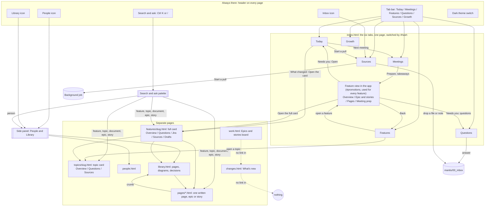

# Site journeys

Every page of the Mantis site at http://localhost:8000, what the owner does there, and where each
action leads. Use it to spot pages nothing links to, buttons that lead nowhere, and things worth
removing. Findings are at the bottom; update them when the site changes.

**How this was made (2026-11-13, quick run):** read from the code (`tools/site_config/layout.json`,
`tools/site_assets/app/`, `tools/pagebuild/`, `tools/webserver/`) and a link crawl of the built site
(61 pages). Nothing was clicked in a browser, so "leads to" means "the code says so". Re-run the
crawl after a build to refresh the link findings.

## The map

Dotted lines mark the gaps listed under Findings.

## The shell (every page)

| Control | What it does | Leads to |
|---|---|---|
| Mantis logo | Go home | Today |
| Tab bar | Switch screen; the URL hash changes (`#today`, `#meetings`, …) | The six tabs |
| Search icon, `Ctrl K`, `/` | Opens the palette: find a person, feature or document, or ask a question | A card, topic, document or person panel |
| Inbox icon | Straight to the place where answers, edits and dropped files wait | Sources |
| People icon | Opens the side panel with everyone; a person shows role, follow-ups, "Brief me", "Draft a message" | People page (link in the panel) |
| Library icon | Opens the same panel on the library list | Library page, Diagrams, Decisions |
| Theme switch | Light or dark, remembered | Same page |
| `G` then `T M F Q S R` | Keyboard jump to a tab | The six tabs |
| `?` | Shortcut sheet | Overlay |

## The six tabs

All six live in `index.html`. The old addresses (`today.html`, `roadmap.html`, …) redirect here.

### Today
*Job: what do I do now, and what changed.*
- **Plan** (tasks for today): tick, snooze, add, edit, reorder, group, show overdue. Saved through `/api/tasks`.
- **What changed**: topics touched by the last pull. Each opens to a short reason and **Open the card** (full feature page).
- **Next**: the next meeting and its first agenda items. **Week**: the week's calendar view.
- **Waiting on**: people who owe something, longest wait first. **Copy chase** puts a follow-up message on the clipboard; a name opens the side panel.
- **Start a pull**: starts a Jira and Confluence fetch as a background job. Progress shows in the header bar and on Sources.
- Leads to: Features (cards), Meetings, Sources, the side panel.

### Meetings
*Job: prepare and capture.*
- Day chips (All, Mon to Fri) and a search box narrow the list.
- Open a meeting: people, what to raise, takeaways. **Brief me** starts a brief job. **New meeting**, **Edit**, **Remove** change the owner's regular meetings (`/api/schedule`).
- Leads to: the People panel, the feature behind an agenda item.

### Features
*Job: see what I own and where each thing stands.*
- Three lists: **Following**, **Topics**, **Archived**, with a filter box. Each row shows what needs the owner, the stage and the source count.
- **Follow / Unfollow** (`/api/focus`) moves a card between lists.
- Open a **feature**: the in-app feature view (below). Open a **topic**: its own page (`topics/<slug>.html`).

### The feature view (inside Features)
Hash `#promotions`, the same screen for every feature (the name is a leftover; see Findings).
- **Overview**: stage (step 1 to 3), priority, effort, Jira link, **Needs you** (tasks, open questions), the card summary, people waiting. **Open the full card** goes to `features/<slug>.html`.
- **Epic and stories**: a list on the left, the text on the right, with copy buttons and edit.
- **Pages**: the Confluence page body with **Copy all**.
- **Meeting prep**: shows only when a prep exists.
- **Back** returns to Features.

### Questions
*Job: settle what is open.*
- Pickers (who, feature, kind) narrow the list. Open a question for context.
- Answer in the bar at the bottom. The answer is saved to the inbox and read on the next pull (`/api/answers`). Nothing is changed straight away; the site says so.
- Leads to: the feature a question belongs to; the side panel for the person who can answer.

### Sources
*Job: feed Mantis and see what it read.*
- **Add material**: paste text or drop a file; both go to the inbox (`/api/inbox`, 15 MB limit).
- **Recently read** (with the feature each fed). **Health**: things that need a look, such as unmapped tickets (**map or skip**, `/api/mapping`).
- **Pull from Jira and Confluence**: the filter list; **New filter**, edit, test, remove (`/api/filters`). **Start a pull**.
- Waiting inbox items (answers, page edits, files) are counted here; the next pull processes them.

### Growth
*Job: the record of wins and what to step up on.*
- Tabs: **Proposed**, **In progress**, **Done**, **Hidden**. Proposals can be added, dismissed, put off until later, restored; several at once.
- **Add your own**: a win, a step or something to learn.
- **Where the evidence sits**: items per area.
- Only the owner adds to the record (`/api/growth`).

## The other pages

| Page | How you get there | What you do | Leads to |
|---|---|---|---|
| `features/<slug>.html` (10) | Today "Open the card", feature view "Open the full card", search | Read the card; tabs Overview, Questions, Jira, Sources, Drafts. Copy a Confluence page, sync only the changed sections, edit text (goes to the inbox), refresh the card | Topic, Library, People panel, drafts and stories |
| `topics/<slug>.html` (20) | Features "Topics", search, topic switcher | Overview, Questions, Sources; **Refresh summary**, **Copy summary**; the owner's tasks for this topic | Sources, People panel |
| `people.html` | People icon panel, search | Filter people; **Brief me**, **Draft a message**, **+ Follow-up** | Side panel per person |
| `library.html` | Library icon, card pages | Chips: All, Pages, Epics, Stories, Diagrams, Decisions | `pages/*.html`, diagrams, decisions |
| `pages/*.html` (10) | Library, search, card Drafts tab | Read, copy, edit a written page, epic or story; an epic lists its stories | Back to Library |
| `work.html` (Epics and stories) | **Only from a stand-alone epic or story page** | Board or list by status; filter by feature, kind, Following | The story or epic page |
| `changes.html` (What's new) | **Nothing links to it** | The last 30 days of changes by day; cards to refresh | Cards and pages |

## Actions that write something

| Action | Where | Stored in | Who acts on it |
|---|---|---|---|
| Answer a question | Questions | inbox | Next pull |
| Edit a page, epic or story | Card pages | inbox | Next pull |
| Drop a file or note | Sources | inbox | Next pull |
| Tasks, follow-ups, deadlines, meetings | Today, Meetings, People | the owner's own settings, saved at once | Nobody; they are the owner's |
| Follow, archive, roadmap | Features | `focus.json` | Reports and checks put these first |
| Filters, mapping | Sources | pull settings | Next pull |
| Growth entries | Growth | growth record | Owner only |
| Start a pull, Brief me, Refresh card | Buttons | background job | Result on Sources, Health and jobs |

## Findings (to fix or remove)

1. **What's new (`changes.html`) is an orphan.** No page or script links to it. Either add an entry (Today "What changed" heading is the natural place) or retire the page and its script `whats-new.js`.
2. **Epics and stories (`work.html`) is nearly an orphan.** Only a stand-alone epic or story page links to it. A feature's own epics are reachable in the feature view, but the cross-feature board is not reachable from the tabs. Decide: link it from Features, or drop it.
3. **Four card pages have no link in the built HTML**: `features/sales-rep-and-hunting.html`, `topics/glossary-and-terms.html`, `topics/problem-library.html`, `topics/users-and-ux.html`. The Features tab is drawn by script, so they may be reachable there. Worth one click-through to confirm.
4. **The feature view is called "promotions" in code** (`S.promotions`, hash `#promotions`) though it serves every feature. Rename the hash to `#feature` when next touched.
5. **Two pages per feature**: the in-app feature view and the full card. They share a summary but show different tabs (Pages and Meeting prep against Jira and Sources). Decide whether the owner needs both.
6. **16 old addresses** only redirect (`roadmap.html`, `graph.html`, `timeline.html`, `backlog.html`, `classic.html` and others). Keep them until the owner is sure no saved link uses them, then delete.
7. **The crawl's two "broken" links** in `library.html` (`/diagrams/*.png`) are root-absolute and resolve when served; not a defect.
8. **Open check, not a site defect:** the safety net reported `tools/README.md` not listing the tools on disk (the new, uncommitted `tools/` scripts).

## Refreshing this document

After a site change, rebuild (`python tools/build_map.py`), re-read the screens in `tools/site_config/layout.json`
and the page builders in `tools/pagebuild/`, and re-check the links. A script that does the crawl on every build
would turn findings 1 to 3 into an automatic check; add it to `docs/project/IMPROVEMENT_BACKLOG.md` if wanted.
